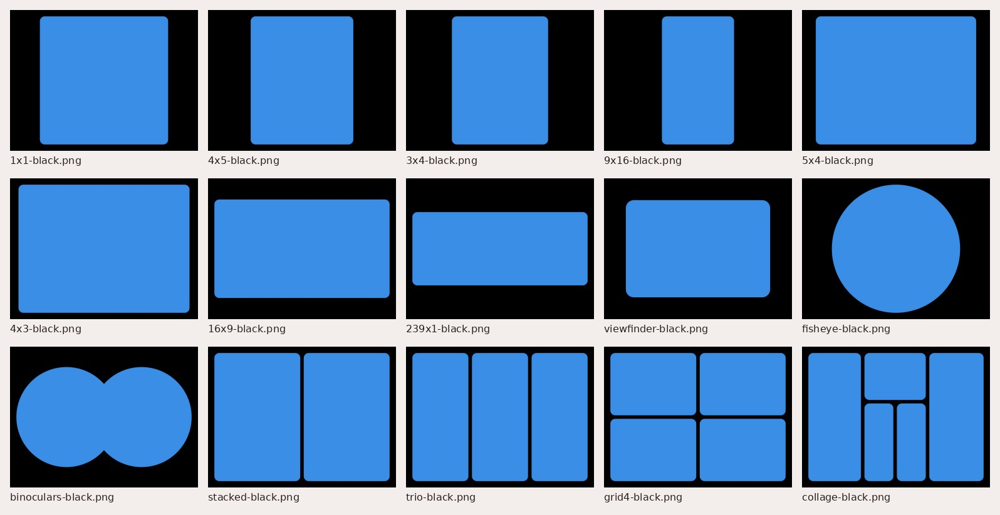

# Frame pack

Frame overlays for photos and video, made by the Carousel Artboard (`tool/index.html`, `drawFrameMatte` / `frameWins`), so they match the board's **Frame** slides exactly.

- Folders by canvas ratio: `3x4`, `4x5`, `9x16` (portrait), `4x3`, `16x9` (landscape). Each canvas is 1800 px on its short side.
- Each frame comes in two colors: `<frame>-black.png` and `<frame>-white.png`. The window is fully see-through, with soft edges.
- Frames: `1x1`, `4x5`, `3x4`, `9x16`, `5x4`, `4x3`, `16x9`, `239x1` (2.39:1 cinema) (a rounded window of that ratio), `viewfinder` (a thick frame with a rounded window), `fisheye` (a circle), `binoculars` (two overlapping circles), `stacked` (2 windows), `trio` (3), `grid4` (2×2) and `collage` (5 windows: strip, tall + two stacked, strip). The multi-window frames run side by side on wide canvases and one above the other on tall ones.
- Use: put the PNG on top of a clip or photo in Edits or CapCut (blend: normal) and scale the clip to fill the window.
- Regenerate them (after changing a frame in the board): open the board, then `window.__framePack()` returns every file as `{path, data}`; the board's **Download the frame pack** button zips the same set.

