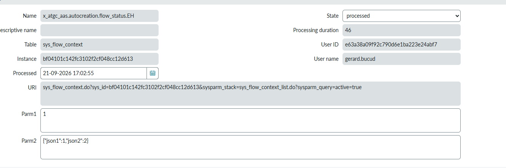
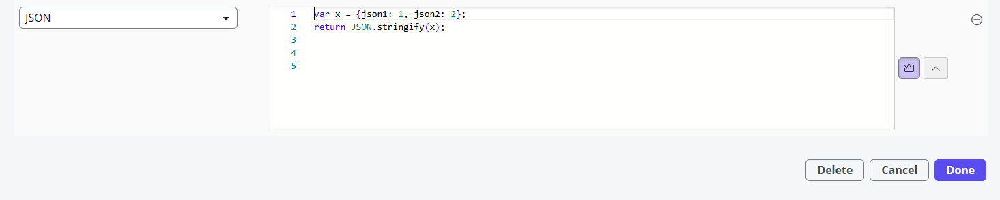
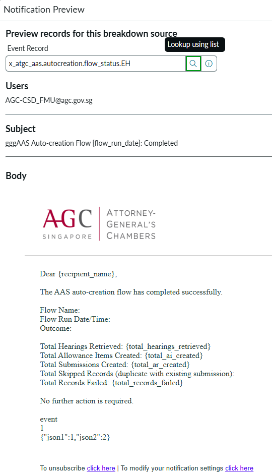
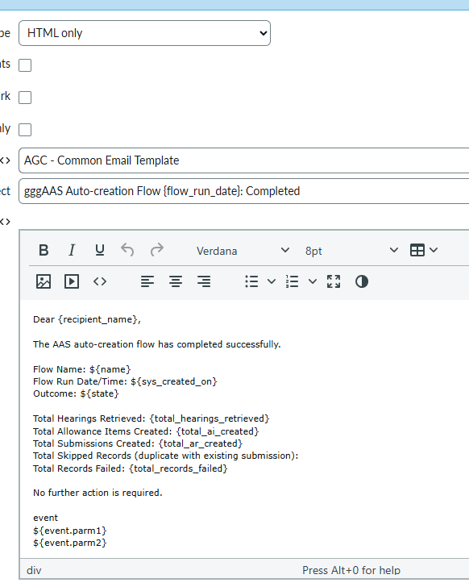

# Passing JSON Parameters via Events in Flow Designer

## Lesson learned

Event parameters (`parm1`, `parm2` on `sys_flow_context` / `sysevent`) are
plain string fields. If a flow action needs to pass a structured object
(e.g. several values needed later to build an email body), you **cannot**
pass the object directly — it must be serialized to a string with
`JSON.stringify()` when the event fires, and then deserialized with
`JSON.parse()` wherever it's consumed (e.g. in the notification/email
script).

## Firing the event

Use a script (JSON data type) to build the payload and stringify it before
passing it as `parm2`:

```js
var x = {json1: 1, json2: 2};
return JSON.stringify(x);
```

This produces a `sys_flow_context` record where `Parm2` is stored as the
string `{"json1":1,"json2":2}` (not an object):





## Consuming the parameter (e.g. in an email body script)

On the receiving end (notification/email script, subscriber, etc.), parse
the string back into an object before using its fields:

```js
var data = JSON.parse(event.parm2);
gs.print(data.json1); // 1
gs.print(data.json2); // 2
```

## Displaying the parsed fields inside a Notification body

`${event.parm1}` / `${event.parm2}` in a Notification (`sysevent_email_action`)
body only print the **raw string** — they don't parse JSON for you. Placeholders
like `{total_hearings_retrieved}` in the body are just literal text unless
something actually substitutes them.





To surface individual fields from the stringified `parm2` payload, use a
**Mail Script** (`sys_script_email`, System Notification > Email > Notification
Email Scripts) instead of referencing `${event.parm2}` directly:

```js
// Mail Script: aas_flow_status_summary
(function runMailScript(current, template, email, email_action, event) {
	var data = {};
	try {
		data = JSON.parse(event.parm2);
	} catch (e) {
		gs.error('aas_flow_status_summary: failed to parse event.parm2 - ' + e);
	}

	template.print('Total Hearings Retrieved: ' + (data.total_hearings_retrieved || 0) + '\n');
	template.print('Total Allowance Items Created: ' + (data.total_ai_created || 0) + '\n');
	template.print('Total Submissions Created: ' + (data.total_ar_created || 0) + '\n');
	template.print('Total Skipped Records (duplicate with existing submission): ' + (data.total_skipped_records || 0) + '\n');
	template.print('Total Records Failed: ' + (data.total_records_failed || 0) + '\n');
})(current, template, email, email_action, event);
```

Then reference it in the notification body in place of the raw
`${event.parm1}` / `${event.parm2}` lines:

```
${mail_script:aas_flow_status_summary}
```

## Takeaway

- Always `JSON.stringify()` before setting an event parm with structured
  data.
- Always `JSON.parse()` on the consuming side before accessing the
  object's properties — the raw `parm2` value is just a string.
- `${event.parm1}` / `${event.parm2}` in a notification body print the raw
  string as-is; to show individual parsed fields, use a Mail Script
  (`${mail_script:<name>}`) that does the `JSON.parse()` and prints the
  values you need.
